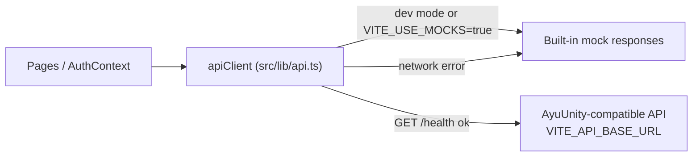

<div align="center">

# AyuUnity · Calm Care (UI prototype)

### Patient-held unified health-records PWA with multi-role professional onboarding

[](https://react.dev/)
[](https://vitejs.dev/)
[](https://www.typescriptlang.org/)
[](https://ui.shadcn.com/)
[](#features)
[](LICENSE)
[](#status)

</div>

> [!NOTE]
> A front-end redesign concept for [AyuUnity](https://github.com/rupeshbharambe24/AyuUnity), built
> with Lovable in November 2025. It is **UI-only**: there is no backend in this repo, and the app
> runs against a built-in mock API (a "Demo Mode" banner is shown). All records, doctors, orders and
> notifications are sample data.

## Overview

AyuUnity Calm Care explores a calmer, patient-first take on AyuUnity: a single place where a
patient (and their family) keeps medical records, books appointments, tracks prescriptions and lab
results, and carries an emergency (ICE) health packet, while doctors, hospitals, pharmacies, labs
and other providers sign up through a verified, approval-based onboarding flow.

### Highlights

- **OTP login** for patients and a separate **professional login**, with `pending` / `denied` approval states
- **12 sign-up flows**: a patient wizard plus 11 professional roles (doctor, AYUSH practitioner, hospital, pharmacy, lab, NGO, government, insurer, corporate, researcher, ambulance) generated from a single role config (`src/lib/roleConfig.ts`) and a reusable multi-step `SignupWizard` (account → role details → documents → declarations)
- **Records vault**, appointments, doctor directory and profiles, hospital directory, pharmacy orders with a status timeline, lab tests and results, family members with vaccinations and medication reminders, payments and health-scheme info, notifications and consent requests
- **Emergency page** with ICE contacts, allergies and current medications ("Emergency Health Packet")
- **Offline support**: service worker caches `/`, `/emergency` and `/offline`; offline banner and fallback page; web app manifest
- **English / Hindi** UI strings (i18next), light / dark theme, zod form validation, responsive navigation rail + app bar
- **Mock-first API client** (`src/lib/api.ts`): pings `GET /health` and silently falls back to mock responses when no server answers

## Screens and routes

<details>
<summary><b>Public and auth routes</b></summary>

| Route | Screen |
|-------|--------|
| `/` | Landing page |
| `/auth/login` | Patient login (phone / email OTP) |
| `/auth/pro-login` | Professional login |
| `/auth/verify-otp` | OTP verification |
| `/auth/signup` | Sign-up role picker |
| `/auth/signup/patient` | Patient sign-up wizard |
| `/auth/signup/{doctor, ayush, hospital, pharmacy, lab, ngo, government, insurer, corporate, researcher, ambulance}` | Professional sign-up wizards |
| `/auth/pending`, `/auth/denied` | Professional account awaiting approval / rejected |
| `/offline` | Offline fallback |

</details>

| Route (signed in) | Screen |
|-------------------|--------|
| `/dashboard` | Home dashboard, recent records, profile completion |
| `/records` | Records vault (lab, imaging, prescriptions, other) |
| `/appointments` | Find a doctor, upcoming appointments |
| `/doctors`, `/doctors/:id` | Doctor directory and profile |
| `/hospitals` | Hospital directory |
| `/pharmacy` | Prescriptions and pharmacy orders |
| `/labs` | Upcoming tests and results |
| `/family` | Family members, vaccinations, medication reminders |
| `/payments` | Payments, insurance and healthcare schemes |
| `/emergency` | ICE contacts and emergency health packet |
| `/notifications` | Reminders, results, sharing and consent requests |
| `/settings` | Profile, accessibility, theme, language |

## How the mock API works



Endpoints the client expects from a real server: `GET /health`, `POST /auth/otp/request`,
`POST /auth/otp/verify`, `GET /auth/session`, `POST /auth/logout`, `POST /auth/signup/<role>`
(plus `/draft`), and `POST /files` for document uploads.

## Status

| Aspect | State |
|--------|-------|
| Screens, navigation, sign-up wizards | Implemented |
| Data | Mock / hard-coded sample data |
| Backend | Not included; the existing [AyuUnity](https://github.com/rupeshbharambe24/AyuUnity) Flask backend does not implement these auth endpoints |

## Tech stack

| Area | Libraries |
|------|-----------|
| Framework | React 18, TypeScript 5, Vite 5 (SWC), React Router 6 |
| UI | Tailwind CSS, shadcn/ui (Radix), lucide-react, Framer Motion |
| Forms | react-hook-form + zod |
| i18n | i18next, react-i18next (en, hi) |
| PWA | `public/manifest.json`, `public/sw.js` |

## Getting started

Prerequisites: Node.js 18+.

```bash
npm install
npm run dev          # http://localhost:8080 (mock API is always on in dev)
```

To point a production build at a real API, copy `.env.example` to `.env.local`, set
`VITE_API_BASE_URL` and `VITE_USE_MOCKS=false`, then `npm run build && npm run preview`.

## Project structure

```text
ayuunity-calm-care/
├── public/                    manifest.json, sw.js, favicon.ico, placeholder.svg (avatar), robots.txt
├── src/
│   ├── pages/                 Dashboard, Records, Appointments, Doctors, DoctorProfile, Hospitals,
│   │                          Pharmacy, Labs, Family, Payments, Emergency, Notifications, Settings,
│   │                          Landing, Offline, NotFound
│   │   └── auth/              Login, ProLogin, VerifyOTP, Signup, Signup<Role> (12), Pending, Denied
│   ├── components/
│   │   ├── layout/            AppBar, NavigationRail, Layout
│   │   ├── professional/      SignupWizard + steps (Account, RoleDetails, DoctorDetails, Documents, Declarations)
│   │   ├── DemoBanner, OfflineBanner, OrderStatusTimeline, ProtectedRoute
│   │   └── ui/                shadcn/ui primitives
│   ├── contexts/              AuthContext, ThemeContext
│   └── lib/                   api (mock-aware client), roleConfig, validation (zod), i18n, i18n-signup
├── .env.example
├── vite.config.ts             dev server :8080, lovable-tagger in dev mode
└── package.json
```

## Related repositories

| Repository | Role |
|------------|------|
| [`AyuUnity`](https://github.com/rupeshbharambe24/AyuUnity) | Main AyuUnity app: Next.js frontend + Flask backend with medical-image, chronic-risk and symptom-checker models |
| **`ayuunity-calm-care`** | This repo: UI redesign prototype (records, onboarding, PWA) |

## License

[MIT](LICENSE) © 2025 Rupesh Bharambe
